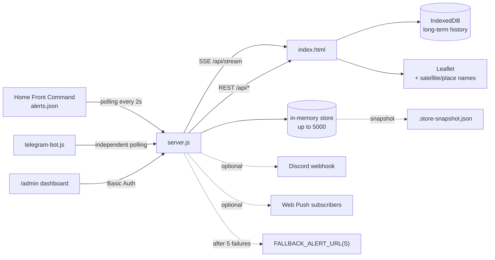

# AGENTS.md

Working guide for coding agents (Codex, Grok, Claude Code, Cursor...). **This is the single source of truth**: `CLAUDE.md` only points here.

> **Technical depth as needed:** [docs/ARCHITECTURE.md](docs/ARCHITECTURE.md): environment variables, server/client details, i18n, PWA, tests. Do not read it whole: `grep` for the relevant section.

## What the project is
**Tzafir** (צפיר; npm package: `tzafir`, formerly `israel-alert-map`, v1.6.5): a Node.js server plus a standalone HTML client that shows Home Front Command (Pikud HaOref) alerts in real time on a Leaflet map. Core dependencies: zero (only `node` ≥ 18). The only optional dependency: `web-push` (for server.js). `telegram-bot.js` has no dependencies at all: it calls the Telegram Bot API over raw `https`. The GitHub repo name stays `RedAlert` on purpose (the branding changed, the repo did not).

Data source: `https://www.oref.org.il/WarningMessages/alert/alerts.json` (polling every 2 seconds). No keys, no signup.

## Architecture — diagram


## File structure
**The application code itself is completely flat** (no `src/`, no subfolders for `server.js`/`index.html`/`lib.js`: this is a deliberate decision). Subfolders exist for **helpers** only: `test/` (tests), `scripts/` (release tools), `docs/` (openapi.yaml + screenshot), `release-banners/` (assets):

| File | Role |
|---|---|
| [server.js](server.js) | A single HTTP server: proxy to OREF, SSE, API, PWA assets, admin dashboard, Web Push, fallback, health webhook, store snapshot. **Built as one file with very dense lines** (deliberate one-liners). |
| [index.html](index.html) | Monolithic client: HTML + CSS + JS in the same file. The whole map, UI, IndexedDB, audio, TTS. **Loads [lib.js](lib.js) synchronously** (`<script src="/lib.js">`) before the inline script. |
| [lib.js](lib.js) | **Single source of truth** for static data (`CITIES`, `LN`, `TM`, `RS`, `SHELTERS_DEFAULT`) and pure functions (`escapeHtml`, `formatShelter`, `shelterClass`, `distanceKm`, `isDND`, `normalizeCity`, `fuzzyMatch`). UMD: works both as a `<script>` in the browser (global `AlertLib`) and as `require('./lib.js')` in Node. The client wraps it in short names (`X`, `C`, `findC`...), the tests import it directly. |
| [test/unit.js](test/unit.js) | Unit tests for `lib.js` through `node:test`. No dependencies. |
| [test/integration.js](test/integration.js) | API-level integration test: starts a mock OREF + a spawned server, verifies an alert flows to `/api/alerts` + SSE + `/api/health`. No browser. |
| [test/e2e.js](test/e2e.js) | Real-browser E2E (Playwright, `channel:'chrome'`: uses the locally installed Chrome, with no bundled browser download). Runs a spawned server and checks real UI regressions caught in the past (search focus, tab persistence, mobile nav width, shelter labels, option colors in dark mode, missing tab labels, history tab collapse). Each test is tied to a specific bug from the CHANGELOG. `playwright` is a `devDependency` only. |
| [telegram-bot.js](telegram-bot.js) | A standalone bot: polls `/api/alerts` and sends to a Telegram channel. **No dependencies**: `sendMessage` to the Telegram Bot API over raw `https` (the same style as `sendDiscord()` in server.js), not `node-telegram-bot-api`. |
| [Dockerfile](Dockerfile) + [docker-compose.yml](docker-compose.yml) | Build on `node:20-alpine` with a healthcheck. |
| [package.json](package.json) | Scripts only; no regular `dependencies`, only `optionalDependencies`. |

Runtime files created automatically (in `.gitignore`):
- `logs/alerts.log`: alert log with rotation (10MB × 5 files)
- `logs/client-errors.log`: JS errors from the client (`POST /api/client-error`), the same rotation policy, a separate file so that bursts of client errors do not push out the alert log
- `logs/admin-audit.log`: every authentication attempt to `/admin`/`/metrics` (success/failure + IP), the same rotation policy
- `.vapid-keys.json`: VAPID keys for Web Push (created on first run)
- `.push-subs.json`: Push subscriptions
- `.store-snapshot.json`: snapshot of the alert history; loaded at startup (as history only, not active) to survive a restart/redeploy

## Run commands
```bash
node server.js              # starts the server on port 3000
node test/unit.js           # 90+ tests (including a server smoke test)
node test/integration.js    # API-level integration: mock OREF → server → SSE
node test/e2e.js            # real-browser E2E: needs local Chrome/Edge + playwright (devDependency)
node telegram-bot.js        # Telegram bot (needs environment variables)
npm install                 # install web-push (optional; telegram-bot.js has no dependencies)
docker-compose up -d        # deploy with Docker

npm start                   # = node server.js
npm test                    # = node test/unit.js
npm run test:integration    # = node test/integration.js
npm run test:e2e            # = node test/e2e.js
npm run test:all            # runs all three in sequence
npm run telegram            # = node telegram-bot.js
npm run docker:build        # docker build -t alertmap .
npm run docker:run          # docker run -p 3000:3000 ...
```

`npm run lint`: ESLint flat config (`eslint.config.js`, "real bug" rules only, `devDependency`). There is no `typecheck`/`format`; the project has almost no toolchain. ⚠️ The lint script does **not** cover `lib.js`, `scripts/` or the inline JS of `index.html` (the largest file).

## How to add a feature / change code
1. **Server logic changes**: edit `server.js` directly. There is no hot reload; restart `node server.js`.
2. **Client changes**: edit `index.html` directly. The server detects the mtime change and serves the new version (browser refresh). Remember that the Service Worker may serve a cached version: bump `CN` (currently `red-alert-v18`) in `server.js` (variable `SW`) to trigger invalidation, or open DevTools → Application → Service Workers → Unregister. If you changed the map tile URL/provider, also bump `TILE` (currently `red-alert-tiles-v2`), otherwise old tiles stay in the separate cache forever (the `activate` handler does not clear it).
3. **Add a city**: edit `CITIES` in [lib.js](lib.js). Format: `"name":{lat:X,lng:Y,r:"region",s:shelter_time}`.
4. **Add a language**: add an entry to `LN`, to `LANG_META` (native name + flag) and to `TTS_LOCALE` (BCP-47 code) in [lib.js](lib.js), including **all** the keys that exist in `LN.en` (test/unit.js and the code do not check this automatically, but a missing key silently falls back to Hebrew). `<select id="langS">` in index.html is built automatically from `LANG_META` through `initLangSelect()`; do not edit it by hand.
5. **New endpoint**: add `if (p === '/api/...')` in `server.js` to the existing pipeline inside `http.createServer`. Remember `track(p, code)` and `gz(req, res, body, ct)`.
6. **Tests**: the pure functions live in [lib.js](lib.js) (single source of truth). The client wraps them in short names, and `test/unit.js` imports `require('../lib.js')`. **If you change pure logic, edit `lib.js`, and that is it.** There is no manual duplication any more.
7. **Add static data** (city/language/alert type): edit the objects in [lib.js](lib.js) (`CITIES`/`LN`/`TM`/`RS`). The client pulls them through `AlertLib`. A city without a coordinate (not found by `fuzzyMatch`) is marked `noLoc:true`: **no marker is placed at a random location** (it appears in the list with an "unknown location" label only).
8. **Publishing a release**: update `package.json`/`APP_VERSION`/`CN` (server.js), add a section to CHANGELOG.md and to `CHANGES` (index.html), and run the tests. **⚠️ Required before tagging: after the push, wait for the Vercel deploy to finish and run `node scripts/smoke.mjs https://red-alert-ten.vercel.app --expect-version X.Y.Z`; only if it passes, mark the tag/release.** (Green tests are not enough: v1.6.4 passed all of them and broke the live site, because `GET /lib.js` returned 404 on Vercel, so there was no map and no UI.) For server/deployment changes, prefer to verify first on a branch → Vercel preview. Every new GitHub release includes **only** `release-banners/vX.Y.Z.png` (a branded logo with the version number, generated automatically by `node scripts/release-banner.mjs <version>`: headless Chrome, no new npm dependency, needs Chrome/Edge installed locally) in the release notes body. **Do not** add `docs/screenshot.jpg` to the release notes body: the user deliberately removed it from v1.5.0/v1.6.0 (it stays only in the README itself, and is updated there when the UI changes significantly). **⚠️ Version numbering after 2026-08-30**: the user asked to renumber the entire history (what was v3.0.0 through v3.6.0 became v1.0.0 through v1.6.0: major lowered from 3 to 1, minor/patch unchanged). **The next version continues from v1.6.5** (for example v1.6.6 for a fix, v1.7.0 for a feature); **do not** jump back to v3.x and **do not** jump to v2.0.0.

## Style conventions
- **Language**: comments and UI text in Hebrew. Variable/function names in English.
- **Density**: the project prefers long one-liners over spacious code. When editing an existing area, keep its style; new areas may be more spacious.
- **No dependencies**: every new server feature should also work when `web-push` is not installed. The installation is optional on purpose.
- **No client framework**: do not add React/Vue. Use the DOM API.
- **Security**: every user/OREF string displayed in HTML must go through `X()` (escape).

## Safety warnings
- **Admin password**: if `ADMIN_PASS` is not set, a random one is generated at startup (printed once to the log). Set a fixed value for production.
- **Open CORS (`*`)**: deliberate; the API is meant for public consumption.
- **CSP allows `unsafe-inline`**: deliberate; the client is monolithic HTML+JS.
- **The Vercel site (red-alert-ten.vercel.app) does not receive real alerts** (verified 2026-10-16): OREF blocks its IP. Before claiming the deployment "works", check that `last_poll_ago` in `/api/health` is a number and not `null`; HTTP 200 alone does not prove data is flowing.
- **The system is not a substitute for Home Front Command instructions.** Emphasize this in every new UI.

## Iron rules (learned the hard way — do not skip)

1. **Do not tag a release before running smoke on the deployed site**: after a push, wait for the deploy, then `node scripts/smoke.mjs https://red-alert-ten.vercel.app --expect-version X.Y.Z`. Green tests are not enough: v1.6.4 passed all of them and broke the live site (`/lib.js` 404, no map).
2. **"Works" = I actually ran it.** A real browser / HTTP against the deployed site / a real Docker, not just reading code. Report honestly what was not verified.
3. **Every bug fix gets a test that fails on the old code** (temporarily bring the bug back and verify the test fails, then restore). Without this the test may pass for nothing (for example, the old "search focus" test passed even when the list was not filtered).
4. **Every test that starts `server.js` must**: use a temporary `DATA_DIR` (otherwise it writes fake alerts into the developer's real history), `OREF_URL_OVERRIDE` pointing to a mock (the Home Front Command blocks non-Israeli IPs, and in CI this would fail the tests), and in a single browser also a high `RATE_LIMIT_PER_MIN` (otherwise random 429s), and pin `locale: 'he-IL'` (the language is chosen by the browser).
5. **Do not `require('./lib.js')` in server.js**: on Vercel this stops deploying the file as an asset (see critical constraints). The same rule applies to every file served to the client from disk.
6. **Do not push / tag / publish a release unless the user asked.** External actions (GitHub, Vercel, deletions) only on explicit request.
7. **Do not bring a screenshot back into the release notes body** (only `release-banners/vX.Y.Z.png`). Version numbering continues from 1.x (not 3.x and not 2.0.0). Keep the root clean: do not add files in the root without a reason (there are `docs/`, `test/`, `scripts/`, `.github/`).
8. **`CLAUDE.md` is a pointer only**: edit only `AGENTS.md`/`docs/*`.

## Working environment

- Windows 11; Git Bash or PowerShell. `git` may fail with "dubious ownership": `export GIT_CONFIG_COUNT=1 GIT_CONFIG_KEY_0=safe.directory GIT_CONFIG_VALUE_0="<repo path>"` (do not change the global config).
- `gh` (GitHub CLI) is connected: releases, tags, PRs, runs. `gh run list --workflow=test.yml --branch main`.
- Chrome is installed locally (E2E and banners). Docker Desktop is installed but sometimes off.
- JS installs: **`pnpm`** (not npm/yarn). Python: `uv`.
- Long scripts with quotes/Hebrew: write them to a file and run it; a shell heredoc breaks easily.
- The user writes and expects answers **in Hebrew**, concise and honest; asks when something is unclear and does not guess; does not like clutter (in the root and in answers).

## Reading the code cheaply (saves tokens)

- `index.html` (~110KB) and `server.js` (~60KB) are made of huge lines of dense code. **Do not read them whole.**
- Search: `grep -n -o "function renderSB.\{0,500\}" index.html` · a section: `sed -n '540,560p' index.html | cut -c1-300`.
- After an edit do not re-read to verify: run `node --check <file>` and the tests. For a full run: `pnpm run lint && node test/unit.js && node test/integration.js && node test/e2e.js`.
- Batch independent commands together; do not launch subagents unless asked.

## Tests — short rules

| Command | What |
|---|---|
| `node test/unit.js` | 114 unit tests for `lib.js`/the Telegram bot |
| `node test/integration.js` | 21 assertions: mock OREF → server → SSE/health/lib.js + a dead-feed scenario + smoke |
| `node test/e2e.js` | 12 real-Chrome tests (Playwright), each tied to a bug that existed |
| `pnpm run lint` | ESLint (does not cover `lib.js`, `scripts/`, and the JS inside `index.html`) |

CI (`.github/workflows/test.yml`) must be green before tagging. `deploy.yml` (Fly.io) is red on every push: known and deliberately not connected (`FLY_API_TOKEN` was not set).

## Critical constraints — required before editing

- **⚠️ Do not `require('./lib.js')` in server.js**: the file is also served to the client from disk (`getLib()`), and on Vercel `require` turns it into a module in the bundle instead of a deployed file: `GET /lib.js` returned 404 and the app died (v1.6.4). The server loads it like this: `new Function('module','exports', fs.readFileSync(…lib.js))`: the same disk read as `/lib.js`, so if the file is served, the load works too. The same rule applies to every file served to the client from disk (`index.html`, `lib.js`, `docs/openapi.yaml`).
- **⚠️ Critical constraint — re-rendering an inactive tab**: `updUI()` (which runs from `schedUI()`/`procSA`/`visibilitychange` etc.) calls `refreshCurrentTab()` and not `renderSB()` directly: `refreshCurrentTab()` checks `currentTab` and updates only the `#sbC` of the tab that is actually active. **Never call `renderSB()`/`renderHistoryTab()` without checking `currentTab` first**: an unconditional call writes the alerts/history content onto `#sbC` even when the user is viewing another tab (this is exactly the bug that was fixed: switching a tab in the browser returned the view to alerts instead of staying on the last tab).
- **⚠️ Critical constraint — live search fields (`#fQ`, `#hQ`)**: `renderSB()`/`renderHistoryTab()` replace the whole `innerHTML` of `#sbC`, including the search field itself. Any change to these functions **must** preserve `document.activeElement`/`selectionStart`/`selectionEnd` before the render and restore them (`focus()`+`setSelectionRange()`) after it, otherwise every keystroke takes focus out of the field (the user cannot type continuously). `renderHistoryTab()` also skips the skeleton loader when the tab is already rendered (first load only), and guards against a race condition with `historySeq` **and** checks `currentTab==='history'` after the `await gDB()`, otherwise switching tabs while IndexedDB is slow paints the history list under another tab. **Two more rules (v1.6.3)**: (1) restoring the field value after a render must come from the **raw** text (`prevVal`/`rawQ`), not from `flt.q`, which goes through `.trim()`, and restoring from it eats the space the user just typed ("תל " → "תלאב"), which breaks every two-word city. (2) A **user-initiated** filter change (`applyF`) must render even when focus is in `#fQ`: the `userFilt` flag; the guard in `refreshCurrentTab()` is meant only for background refreshes (SSE/timers) and not for the user's own keystrokes. The old "keeps focus" test passed even when the list was not filtered at all, because no render happened, so the tests now check both that the list actually narrows and that the keyboard keeps working midway.
- **⚠️ Critical constraint — `sDB()` does not save `type`**: records in IndexedDB (`sDB()`) save only `typeKey` (a string), not the full `type` object (icon/css/color) that `rItem()`/`addMrk()` require. `renderHistoryTab()` restores it manually (`a.type=TM[a.typeKey]||TM.rockets`) after `gDB()`. **This was a real, long-running bug**: before the fix, every visit to the history tab with real IndexedDB data crashed on `Cannot read properties of undefined (reading 'icon')` and was stuck on the skeleton loader forever. If you add another place that reads raw records from `gDB()`/IndexedDB, check this again. There is an E2E test for this regression (`test/e2e.js`, which manually seeds a record in IndexedDB in the exact format of `sDB()`).
