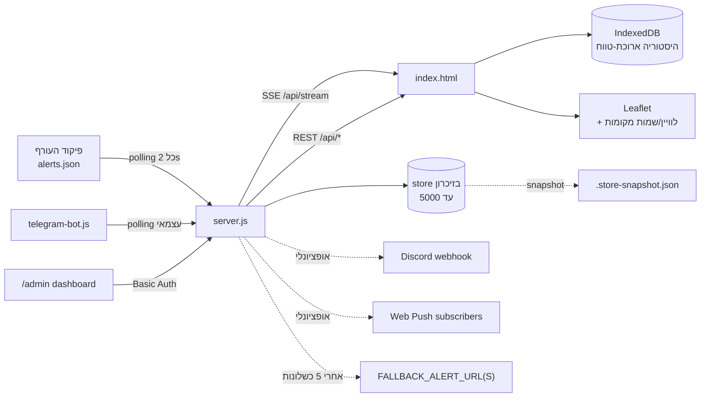

# AGENTS.md

מדריך עבודה לסוכני קוד (Codex, Grok, Claude Code, Cursor...). **זה מקור האמת היחיד** — `CLAUDE.md` רק מפנה לכאן.

> **קרא קודם:** [docs/HANDOFF.md](docs/HANDOFF.md) — מצב נוכחי, משימות פתוחות והעדפות המשתמש (קצר).
> **עומק טכני לפי צורך:** [docs/ARCHITECTURE.md](docs/ARCHITECTURE.md) — משתני סביבה, פירוט שרת/קליינט, i18n, PWA, בדיקות. אל תקרא אותו כולו: `grep` לסעיף הרלוונטי.

## מה הפרויקט
**צפיר** (Tzafir; חבילת npm: `tzafir`, לשעבר `israel-alert-map`, v1.6.5) — שרת Node.js + קליינט HTML עצמאי שמציג בזמן אמת את אזעקות פיקוד העורף על מפת Leaflet. תלות בליבה: אפס (רק `node` ≥ 18). תלות אופציונלית יחידה: `web-push` (ל-server.js). `telegram-bot.js` ללא תלויות בכלל — קורא ל-Telegram Bot API דרך `https` גולמי. שם ה-repo ב-GitHub נשאר `RedAlert` במכוון (המיתוג שונה, ה-repo לא שונה).

מקור הנתונים: `https://www.oref.org.il/WarningMessages/alert/alerts.json` (polling כל 2 שניות). אין מפתחות, אין הרשמה.

## ארכיטקטורה — תרשים


## מבנה הקבצים
**קוד האפליקציה עצמו שטוח לחלוטין** (אין `src/`, אין תיקיות משנה ל-`server.js`/`index.html`/`lib.js` — זו החלטה מכוונת). יש תיקיות משנה ל**עזר** בלבד: `test/` (טסטים), `scripts/` (כלי release), `docs/` (openapi.yaml + screenshot), `release-banners/` (נכסים):

| קובץ | תפקיד |
|---|---|
| [server.js](server.js) | שרת HTTP יחיד — proxy ל-OREF, SSE, API, PWA assets, admin dashboard, Web Push, fallback, health webhook, store snapshot. **בנוי כקובץ אחד עם שורות צפופות מאוד** (one-liners מכוונים). |
| [index.html](index.html) | קליינט מונוליטי — HTML + CSS + JS באותו קובץ. כל המפה, ה-UI, IndexedDB, audio, TTS. **טוען את [lib.js](lib.js) באופן סינכרוני** (`<script src="/lib.js">`) לפני הסקריפט הפנימי. |
| [lib.js](lib.js) | **מקור-אמת יחיד** ל-data סטטי (`CITIES`, `LN`, `TM`, `RS`, `SHELTERS_DEFAULT`) ופונקציות פניניות (`escapeHtml`, `formatShelter`, `shelterClass`, `distanceKm`, `isDND`, `normalizeCity`, `fuzzyMatch`). UMD — עובד גם כ-`<script>` בדפדפן (גלובל `AlertLib`) וגם כ-`require('./lib.js')` ב-Node. הקליינט עוטף בשמות קצרים (`X`, `C`, `findC`...), הטסטים מייבאים ישירות. |
| [test/unit.js](test/unit.js) | בדיקות יחידה ל-`lib.js` דרך `node:test`. ללא תלויות. |
| [test/integration.js](test/integration.js) | בדיקת אינטגרציה ברמת ה-API — מקים mock OREF + spawned server, מאמת אזעקה זורמת ל-`/api/alerts` + SSE + `/api/health`. ללא דפדפן. |
| [test/e2e.js](test/e2e.js) | E2E בדפדפן אמיתי (Playwright, `channel:'chrome'` — משתמש ב-Chrome המותקן מקומית, בלי הורדת דפדפן bundled). מריץ spawned server + בודק רגרסיות UI אמיתיות שנתפסו בעבר (פוקוס בחיפוש, שימור טאב, רוחב ניווט מובייל, תוויות מקלטים, צבעי option במצב כהה, תוויות טאב חסרות, קריסת טאב היסטוריה) — כל טסט מקושר לבאג ספציפי מה-CHANGELOG. `playwright` הוא `devDependency` בלבד. |
| [telegram-bot.js](telegram-bot.js) | בוט עצמאי — polling ל-`/api/alerts` ושליחה לערוץ טלגרם. **ללא תלויות** — `sendMessage` ל-Telegram Bot API דרך `https` גולמי (אותו סגנון כמו `sendDiscord()` ב-server.js), לא `node-telegram-bot-api`. |
| [Dockerfile](Dockerfile) + [docker-compose.yml](docker-compose.yml) | בנייה ל-`node:20-alpine` עם healthcheck. |
| [package.json](package.json) | scripts בלבד; ללא `dependencies` רגילים, רק `optionalDependencies`. |

קבצי runtime שנוצרים אוטומטית (ב-`.gitignore`):
- `logs/alerts.log` — לוג אזעקות עם רוטציה (10MB × 5 קבצים)
- `logs/client-errors.log` — שגיאות JS מהקליינט (`POST /api/client-error`), אותה מדיניות רוטציה, קובץ נפרד כדי שהתקפי שגיאות מקליינטים לא ידחקו את לוג האזעקות
- `logs/admin-audit.log` — כל ניסיון אימות ל-`/admin`/`/metrics` (הצלחה/כישלון + IP), אותה מדיניות רוטציה
- `.vapid-keys.json` — מפתחות VAPID ל-Web Push (נוצרים בהפעלה ראשונה)
- `.push-subs.json` — הרשמות Push
- `.store-snapshot.json` — snapshot של היסטוריית האזעקות; נטען בהפעלה (כ-history בלבד, לא active) כדי לשרוד restart/redeploy

## פקודות הפעלה
```bash
node server.js              # מפעיל את השרת על פורט 3000
node test/unit.js           # 90+ בדיקות (כולל smoke test לשרת)
node test/integration.js    # אינטגרציה ברמת API — mock OREF → server → SSE
node test/e2e.js            # E2E בדפדפן אמיתי — דורש Chrome/Edge מקומי + playwright (devDependency)
node telegram-bot.js        # בוט טלגרם (דורש משתני סביבה)
npm install                 # התקנת web-push (אופציונלי; telegram-bot.js ללא תלויות)
docker-compose up -d        # פריסה ב-Docker

npm start                   # = node server.js
npm test                    # = node test/unit.js
npm run test:integration    # = node test/integration.js
npm run test:e2e            # = node test/e2e.js
npm run test:all            # הריצה של שלושתם ברצף
npm run telegram            # = node telegram-bot.js
npm run docker:build        # docker build -t alertmap .
npm run docker:run          # docker run -p 3000:3000 ...
```

`npm run lint` — ESLint flat config (`eslint.config.js`, כללי "באג אמיתי" בלבד, `devDependency`). אין `typecheck`/`format` — הפרויקט כמעט ללא toolchain. ⚠️ סקריפט ה-lint **לא** מכסה את `lib.js`, `scripts/` ואת ה-JS הפנימי של `index.html` (הקובץ הגדול ביותר).

## איך להוסיף תכונה / לשנות קוד
1. **שינויים בלוגיקת השרת** — `server.js` ערוך ישירות. אין hot reload — `node server.js` מחדש.
2. **שינויים בקליינט** — `index.html` ערוך ישירות. השרת מזהה את שינוי ה-mtime ומגיש את הגרסה החדשה (refresh בדפדפן). זכור ש-Service Worker עלול להגיש cached גרסה — חשוב ל-bump את `CN` (כרגע `red-alert-v18`) ב-`server.js` (משתנה `SW`) כדי להפעיל invalidate, או לפתוח DevTools → Application → Service Workers → Unregister. אם שינית URL/ספק של אריחי מפה — bump גם את `TILE` (כרגע `red-alert-tiles-v2`), אחרת אריחים ישנים נשארים במטמון הנפרד לצמיתות (ה-`activate` handler לא מנקה אותו).
3. **הוספת עיר** — ערוך את `CITIES` ב-[lib.js](lib.js). פורמט: `"שם":{lat:X,lng:Y,r:"אזור",s:זמן_מיגון}`.
4. **הוספת שפה** — הוסף ערך ל-`LN`, ל-`LANG_META` (שם native + דגל) ול-`TTS_LOCALE` (קוד BCP-47) ב-[lib.js](lib.js) — כולל **כל** המפתחות שקיימים ב-`LN.en` (test/unit.js/הקוד לא בודקים זאת אוטומטית, אבל חוסר מפתח נופל חזרה ל-Hebrew בשקט). `<select id="langS">` ב-index.html נבנה אוטומטית מ-`LANG_META` דרך `initLangSelect()` — אין לערוך אותו ידנית.
5. **endpoint חדש** — הוסף `if (p === '/api/...')` ב-`server.js` ל-pipeline הקיים בתוך `http.createServer`. תזכור `track(p, code)` ו-`gz(req, res, body, ct)`.
6. **בדיקות** — הפונקציות הפניניות חיות ב-[lib.js](lib.js) (מקור-אמת יחיד). הקליינט עוטף בשמות קצרים, ו-`test/unit.js` מייבא `require('../lib.js')`. **אם משנים לוגיקה פנינית — עורכים את `lib.js`, וזהו.** אין יותר שכפול ידני.
7. **הוספת data סטטי** (עיר/שפה/סוג אזעקה) — עורכים את האובייקטים ב-[lib.js](lib.js) (`CITIES`/`LN`/`TM`/`RS`). הקליינט מושך אותם דרך `AlertLib`. עיר ללא קואורדינטה (לא נמצאה ב-`fuzzyMatch`) מסומנת `noLoc:true` — **לא מוצב מרקר במיקום אקראי** (היא מופיעה ברשימה עם תווית "מיקום לא ידוע" בלבד).
8. **פרסום release** — עדכנו `package.json`/`APP_VERSION`/`CN` (server.js), הוסיפו סעיף ל-CHANGELOG.md + ל-`CHANGES` (index.html), והריצו את הטסטים. **⚠️ חובה לפני תיוג: אחרי ה-push, חכו שה-deploy ב-Vercel יסתיים והריצו `node scripts/smoke.mjs https://red-alert-ten.vercel.app --expect-version X.Y.Z` — רק אם עבר מסמנים תג/release.** (טסטים ירוקים לא מספיקים: v1.6.4 עבר את כולם ושבר את האתר החי — `GET /lib.js` החזיר 404 ב-Vercel, אז לא הייתה מפה ולא ממשק.) לשינויים בשרת/פריסה עדיף לאמת קודם על ענף → preview של Vercel. כל release חדש ב-GitHub כולל **רק** את `release-banners/vX.Y.Z.png` (לוגו ממותג עם מספר הגרסה, נוצר אוטומטית ע״י `node scripts/release-banner.mjs <version>` — headless Chrome, ללא תלות npm חדשה, דורש Chrome/Edge מותקן מקומית) בגוף ה-release notes. **אין** להוסיף את `docs/screenshot.jpg` לגוף ה-release notes — המשתמש הסיר אותו במכוון מ-v1.5.0/v1.6.0 (הוא נשאר רק ב-README עצמו, ומתעדכן שם כשה-UI משתנה משמעותית). **⚠️ מספור גרסאות אחרי 2026-08-30**: המשתמש ביקש למספר-מחדש את כל ההיסטוריה (מה שהיה v3.0.0 עד v3.6.0 הפך ל-v1.0.0 עד v1.6.0 — major הורד מ-3 ל-1, minor/patch נשארו זהים). **הגרסה הבאה ממשיכה מ-v1.6.5** (למשל v1.6.6 לתיקון, v1.7.0 לפיצ'ר) — **לא** לקפוץ בחזרה ל-v3.x ו**לא** לקפוץ ל-v2.0.0.

## מוסכמות סגנון
- **שפה**: הערות וטקסט UI בעברית. שמות משתנים/פונקציות באנגלית.
- **דחיסה**: הפרויקט מעדיף one-liners ארוכים על קוד מרווח. כשעורכים אזור קיים — שמרו על הסגנון; אזורים חדשים יכולים להיות נשימים יותר.
- **ללא תלויות**: כל פיצ'ר חדש בשרת אמור לעבוד גם כש-`web-push` לא מותקן. ההתקנה היא אופציונלית בכוונה.
- **אין framework בקליינט**: לא להוסיף React/Vue. השתמש ב-DOM API.
- **אבטחה**: כל מחרוזת מהמשתמש/OREF שמוצגת ב-HTML חייבת לעבור `X()` (escape).

## אזהרות בטיחות
- **סיסמת אדמין** — אם `ADMIN_PASS` לא מוגדרת, מוגרלת אקראית בהפעלה (מודפסת ללוג פעם אחת). הגדר ערך קבוע ל-production.
- **CORS פתוח (`*`)** — מכוון; ה-API נועד לצריכה ציבורית.
- **CSP מתיר `unsafe-inline`** — מכוון; הקליינט הוא HTML+JS מונוליטי.
- **אתר Vercel (red-alert-ten.vercel.app) לא מקבל אזעקות אמיתיות** (אומת 2026-10-16) — OREF חוסם את ה-IP שלו. לפני שמצהירים שהפריסה "עובדת" יש לבדוק ש-`last_poll_ago` ב-`/api/health` הוא מספר ולא `null`; HTTP 200 לבדו לא מוכיח זרימת נתונים.
- **המערכת אינה חליפה להנחיות פיקוד העורף**. הדגש את זה בכל UI חדש.

## כללי ברזל (נלמדו בדרך הקשה — אל תדלג)

1. **לא מתייגים release לפני שמריצים smoke על האתר הפרוס**: אחרי push לחכות ל-deploy, ואז `node scripts/smoke.mjs https://red-alert-ten.vercel.app --expect-version X.Y.Z`. טסטים ירוקים לא מספיקים — v1.6.4 עבר את כולם ושבר את האתר החי (`/lib.js` 404, אין מפה).
2. **"עובד" = הורצתי בפועל.** דפדפן אמיתי / HTTP מול האתר הפרוס / Docker אמיתי — לא רק קריאת קוד. דווחו בכנות מה לא אומת.
3. **כל תיקון באג מקבל טסט שנכשל על הקוד הישן** (החזר זמנית את הבאג ואמת שהטסט נופל, ואז שחזר). בלי זה הטסט עשוי לעבור סתם (למשל הטסט הישן של "פוקוס בחיפוש" עבר גם כשהרשימה לא סוננה).
4. **כל טסט שמרים `server.js` חייב**: `DATA_DIR` זמני (אחרת הוא כותב אזעקות מדומות להיסטוריה האמיתית של המפתח), `OREF_URL_OVERRIDE` ל-mock (פיקוד העורף חוסם IP לא-ישראלי, ב-CI זה יפיל טסטים), ובדפדפן אחד גם `RATE_LIMIT_PER_MIN` גבוה (אחרת 429 אקראי), ולנעול `locale: 'he-IL'` (השפה נבחרת לפי הדפדפן).
5. **אל תעשו `require('./lib.js')` ב-server.js** — ב-Vercel זה מפסיק לפרוס את הקובץ כנכס (ראו אילוצים קריטיים). אותו כלל לכל קובץ שמוגש ללקוח מהדיסק.
6. **אין לדחוף / לתייג / לפרסם release בלי שהמשתמש ביקש.** פעולות חיצוניות (GitHub, Vercel, מחיקות) — רק לפי בקשה מפורשת.
7. **אל תחזירו screenshot לגוף ה-release notes** (רק `release-banners/vX.Y.Z.png`). מספור גרסאות ממשיך מ-1.x (לא 3.x ולא 2.0.0). השורש נשאר נקי — אל תוסיפו קבצים בשורש בלי סיבה (יש `docs/`, `test/`, `scripts/`, `.github/`).
8. **`CLAUDE.md` הוא הפניה בלבד** — עורכים רק `AGENTS.md`/`docs/*`.

## סביבת העבודה

- Windows 11; Git Bash או PowerShell. `git` עלול להיכשל ב-"dubious ownership": `export GIT_CONFIG_COUNT=1 GIT_CONFIG_KEY_0=safe.directory GIT_CONFIG_VALUE_0="<נתיב הריפו>"` (לא לשנות config גלובלי).
- `gh` (GitHub CLI) מחובר: releases, tags, PRs, runs. `gh run list --workflow=test.yml --branch main`.
- Chrome מותקן מקומית (E2E ובאנרים). Docker Desktop מותקן אך לפעמים כבוי.
- התקנות JS: **`pnpm`** (לא npm/yarn). Python: `uv`.
- סקריפטים ארוכים עם גרשיים/עברית: כתבו לקובץ והריצו אותו; heredoc ב-shell נשבר בקלות.
- המשתמש כותב ומצפה לתשובות **בעברית**, תמציתיות וכנות; שואל כשמשהו לא ברור ולא מנחש; לא אוהב עומס (בשורש וגם בתשובות).

## קריאת הקוד בזול (חוסך טוקנים)

- `index.html` (~110KB) ו-`server.js` (~60KB) בנויים משורות ענקיות של קוד דחוס. **אל תקראו אותם בשלמותם.**
- חיפוש: `grep -n -o "function renderSB.\{0,500\}" index.html` · קטע: `sed -n '540,560p' index.html | cut -c1-300`.
- אחרי עריכה אל תקראו שוב לאימות — הריצו `node --check <file>` והטסטים. להרצה מלאה: `pnpm run lint && node test/unit.js && node test/integration.js && node test/e2e.js`.
- אצווה פקודות עצמאיות יחד; אל תפעילו סוכני-משנה אלא אם התבקשתם.

## בדיקות — כללים קצרים

| פקודה | מה |
|---|---|
| `node test/unit.js` | 114 בדיקות יחידה ל-`lib.js`/בוט טלגרם |
| `node test/integration.js` | 21 assertions: mock OREF → שרת → SSE/health/lib.js + תרחיש פיד מת + smoke |
| `node test/e2e.js` | 12 טסטי Chrome אמיתי (Playwright), כל אחד מקושר לבאג שהיה |
| `pnpm run lint` | ESLint (לא מכסה `lib.js`, `scripts/`, וה-JS שבתוך `index.html`) |

CI (`.github/workflows/test.yml`) חייב להיות ירוק לפני תיוג. `deploy.yml` (Fly.io) אדום בכל push — ידוע ובכוונה לא מחובר (`FLY_API_TOKEN` לא הוגדר).

## אילוצים קריטיים — חובה לפני עריכה

- **⚠️ אל תעשו `require('./lib.js')` ב-server.js**: הקובץ מוגש גם ללקוח מהדיסק (`getLib()`), וב-Vercel `require` הופך אותו למודול ב-bundle במקום לקובץ שנפרס — `GET /lib.js` החזיר 404 והאפליקציה מתה (v1.6.4). השרת טוען אותו כך: `new Function('module','exports', fs.readFileSync(…lib.js))` — אותה קריאת דיסק של `/lib.js`, כך שאם הקובץ מוגש, גם הטעינה עובדת. אותו כלל לכל קובץ שמוגש ללקוח מהדיסק (`index.html`, `lib.js`, `docs/openapi.yaml`).
- **⚠️ אילוץ קריטי — רינדור מחדש של טאב לא-פעיל**: `updUI()` (שרץ מ-`schedUI()`/`procSA`/`visibilitychange` וכו') קורא ל-`refreshCurrentTab()` ולא ל-`renderSB()` ישירות — `refreshCurrentTab()` בודק את `currentTab` ומעדכן רק את `#sbC` של הטאב הפעיל בפועל. **לעולם אל תקראו ל-`renderSB()`/`renderHistoryTab()` בלי בדיקת `currentTab` קודם** — קריאה לא-מותנית כותבת על `#sbC` את תוכן האזעקות/היסטוריה גם כשמשתמש צופה בטאב אחר (זה בדיוק הבאג שתוקן: מעבר טאב בדפדפן החזיר את התצוגה לאזעקות במקום להישאר בטאב האחרון).
- **⚠️ אילוץ קריטי — שדות חיפוש חיים (`#fQ`, `#hQ`)**: `renderSB()`/`renderHistoryTab()` מחליפים את כל ה-`innerHTML` של `#sbC`, כולל את שדה החיפוש עצמו. כל שינוי בפונקציות האלה **חייב** לשמר `document.activeElement`/`selectionStart`/`selectionEnd` לפני ה-render ולשחזר אותם (`focus()`+`setSelectionRange()`) אחריו, אחרת כל הקשה במקלדת מוציאה את הפוקוס מהשדה (המשתמש לא יכול להקליד ברצף). `renderHistoryTab()` גם מדלג על ה-skeleton loader כשהטאב כבר מרונדר (רק בטעינה ראשונה), ומגן מפני race condition עם `historySeq` **וגם** בודק `currentTab==='history'` אחרי ה-`await gDB()` — אחרת מעבר טאב בזמן שה-IndexedDB איטי צובע את רשימת ההיסטוריה מתחת לטאב אחר. **שני כללים נוספים (v1.6.3)**: (1) שחזור ערך השדה אחרי רינדור חייב להיות מהטקסט **הגולמי** (`prevVal`/`rawQ`), לא מ-`flt.q` — הוא עובר `.trim()` ושחזור ממנו אוכל את הרווח שהמשתמש הרגע הקליד ("תל " → "תלאב"), מה ששובר כל עיר דו-מילית. (2) שינוי פילטר **יזום ע״י המשתמש** (`applyF`) חייב לרנדר גם כשהפוקוס ב-`#fQ` — דגל `userFilt`; ה-guard ב-`refreshCurrentTab()` מיועד רק לרענוני רקע (SSE/טיימרים) ולא לתקתוקי המשתמש עצמו. הטסט הישן "keeps focus" עבר גם כשהרשימה לא סוננה בכלל, כי שום רינדור לא קרה — לכן הטסטים בודקים עכשיו גם שהרשימה באמת מצטמצמת וגם שהמקלדת ממשיכה לעבוד באמצע.
- **⚠️ אילוץ קריטי — `sDB()` לא שומר `type`**: רשומות ב-IndexedDB (`sDB()`) שומרות רק `typeKey` (מחרוזת), לא את אובייקט `type` המלא (icon/css/color) ש-`rItem()`/`addMrk()` דורשים. `renderHistoryTab()` משחזר אותו ידנית (`a.type=TM[a.typeKey]||TM.rockets`) אחרי `gDB()` — **זה היה באג אמיתי וארוך-טווח**: לפני התיקון, כל ביקור בטאב היסטוריה עם נתוני IndexedDB אמיתיים קרס על `Cannot read properties of undefined (reading 'icon')` ותקוע על ה-skeleton loader לנצח. אם מוסיפים עוד מקום שקורא רשומות גולמיות מ-`gDB()`/IndexedDB — לבדוק את זה שוב. יש טסט E2E ל-regression הזה (`test/e2e.js`, זורע רשומה ידנית ב-IndexedDB בפורמט המדויק של `sDB()`).
