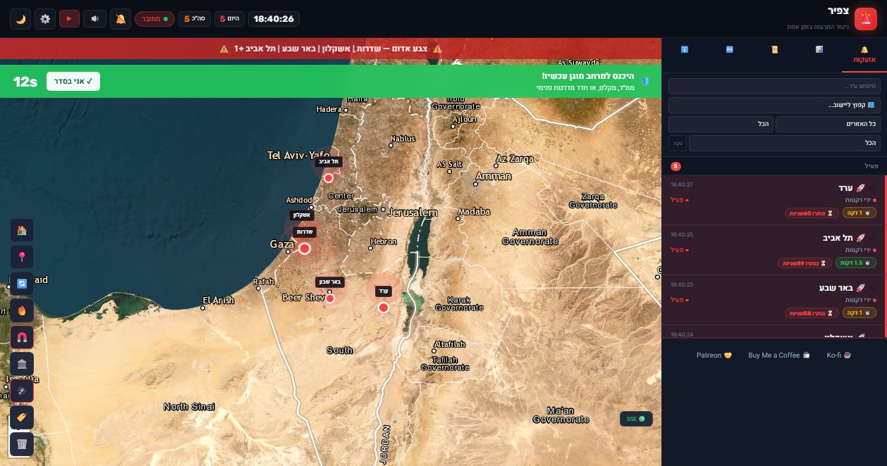
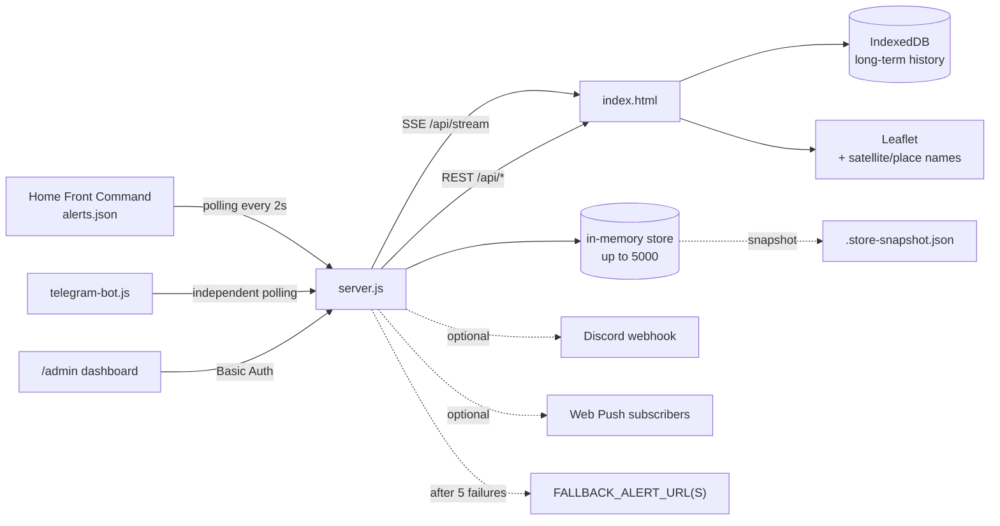

# 🚨 Tzafir (צפיר) | Real-time Home Front Command alert monitoring

> Roadmap: [ROADMAP.md](ROADMAP.md)

<div align="center">

**Real-time alert monitoring with an interactive map**
*(formerly "Israel Alert Map" / israel-alert-map: same project, new branding)*

English · [עברית](README.he.md)

[](https://nodejs.org/)
[]()
[](LICENSE)
[](Dockerfile)
[]()
[](.github/CONTRIBUTING.md)
[](https://ko-fi.com/idanlights)
[](https://buymeacoffee.com/MrIdan)
[](https://www.patreon.com/c/IdanLights)

**🌐 [Live demo: red-alert-ten.vercel.app](https://red-alert-ten.vercel.app)**

> ⚠️ **The demo site does not receive real alerts.** The Home Front Command blocks requests from outside Israel, and Vercel runs abroad. Since v1.6.4 the site shows a "no connection to the data source" warning banner instead of "all quiet". For real alerts, run the server from an Israeli IP address (see [Deployment](#vercel-in-use--this-is-the-live-demo-above-no-real-alerts)).

</div>

<p align="center"></p>

> ⚠️ **This system is for information only and does not replace Home Front Command instructions.**

---

## 🎯 What is it?

A real-time web app that shows Home Front Command alerts on an interactive map. A Node.js proxy server with SSE, no external core dependencies, and a PWA that can be installed as an app.

## 🚀 Quick start

```bash
git clone https://github.com/DrummingBird1/RedAlert.git tzafir
cd tzafir
node server.js
# → http://localhost:3000
```

### With Docker

```bash
docker-compose up -d
```

### With optional extras

```bash
npm install                    # web-push (the Telegram bot has no dependencies, see below)
ADMIN_PASS=secret node server.js
```

---

## ✨ Features (30+)

### Map and visualization
- 🗺️ **Interactive map**: Leaflet.js with dark/light tiles
- 📍 **Animated markers**: pulsing red for active alerts, gray for history
- 🧲 **Marker clustering**: automatic grouping when zoomed out
- 🔥 **Heat map**: a layer showing areas with concentrated alerts
- 🏛️ **Public shelters**: a shelter layer on the map, with navigation (Waze/Google Maps) from any marker. Real data for Tel Aviv-Yafo, Jerusalem and Haifa; other cities are illustrative (see `SHELTERS_URL`)
- 📍 **My location**: GPS plus distance in km from each alert
- 🛰️ **Satellite view**: free Esri World Imagery layer (no API key), toggled with the 🛰️ button

### Alerts and information
- ⏱️ **Shelter time**: per locality (~57 built-in localities), based on Home Front Command data
- ⏳ **Live countdown**: "23 seconds left" on every active alert
- 🛡️ **Protection instructions**: a green panel with instructions and a central countdown
- 🔍 **Fuzzy city matching**: "תל אביב - יפו" finds "תל אביב"
- 🔎 **Filter and search**: by region, alert type, time range, and free-text locality search
- 📜 **History tab**: every alert saved in IndexedDB (not just the latest in memory), with a date range (today/yesterday/week/month/all) and search

### Notifications
- 🔔 **Push notifications**: system notifications (Browser Notification API)
- 📡 **Web Push**: VAPID keys plus a Service Worker (with `npm i web-push`); ⭐ favorites are sent to the server and filter pushes automatically
- 🗣️ **TTS voice announcement**: city names read aloud on alert, in any of the 14 supported languages; all new cities in the same batch are read in one announcement
- 📢 **Siren loop**: an Israeli-style siren (400-900Hz) during an active alert
- 🌙 **Do not disturb (DND)**: no sound between 23:00 and 07:00
- ⭐ **Favorite cities**: push only for the cities you choose
- 📢 **Discord webhook**: sends an embed to a Discord channel for every new real alert (`DISCORD_WEBHOOK_URL`)

### Statistics
- 📊 **24-hour timeline**: a real-time Canvas chart
- 📈 **Historical comparison**: today vs yesterday vs weekly average (IndexedDB)
- 📥 **CSV/JSON export**: with a BOM so Hebrew opens correctly in Excel

### Accessibility and multilingual
- 🌐 **14 languages**: Hebrew, English, Arabic, Russian, Amharic, Tigrinya, Thai, Tagalog, Ukrainian, French, Spanish, Romanian, Hindi, Chinese, with automatic RTL/LTR (chosen for significant communities in Israel: immigrants, migrant workers and asylum seekers; the Amharic and Tigrinya translations are best-effort and should be verified by a native speaker)
- 🕐 **Digital clock**: a 24-hour clock with seconds in the header
- ♿ **ARIA**: roles, aria-live, sr-only, keyboard navigation
- 🔲 **High contrast**: a high-contrast mode for low-vision users
- 🎬 **Reduced motion**: honors `prefers-reduced-motion`
- 🌙 **Auto dark mode**: `prefers-color-scheme` plus night-time detection

### Mobile and PWA
- 🆕 **"Updates" tab**: the latest changes inside the app itself, including a one-time "what's new" popup after each version update
- 📱 **Bottom navigation**: a bottom navigation bar for mobile, with a bottom sheet
- 📲 **PWA**: installable on mobile and desktop ("Add to home screen")
- 🔄 **Service Worker**: network-first with cache fallback
- 📵 **Offline**: automatic detection and loading from IndexedDB

### Server and operations
- ⚡ **SSE**: Server-Sent Events, with polling fallback
- 📦 **Gzip**: automatic compression for any content over 1KB
- 🛡️ **CSP and security**: Content-Security-Policy, X-Frame-Options, rate limiting
- 🔄 **Fallback**: automatic switch to a backup source after 5 OREF failures
- 📡 **Health webhook**: POST to any URL when the system degrades
- 🛡️ **Admin dashboard**: `/admin` with 12 real-time metrics
- 📄 **File logging**: rotation at 10MB × 5 files
- 💾 **IndexedDB**: local history that survives a refresh

---

## 📁 Project structure

```
tzafir/
├── server.js              # Node.js server: proxy, SSE, API, PWA, admin, snapshot
├── index.html             # Client: map, UI, all logic (loads lib.js)
├── lib.js                 # Single source of truth: data + pure functions (UMD; client + tests)
├── package.json           # Metadata + npm scripts
├── Dockerfile             # Docker image + healthcheck
├── docker-compose.yml     # One-click deployment
├── fly.toml               # Fly.io deployment config
├── telegram-bot.js        # Telegram bot (standalone)
├── test/
│   ├── unit.js             # Unit tests (node:test) for lib.js
│   ├── integration.js      # API-level integration: mock OREF → server → SSE
│   └── e2e.js               # Real-browser E2E (Playwright)
├── scripts/
│   ├── release-banner.mjs  # Generates the branded banner for each release
│   └── smoke.mjs           # Smoke test for a deployed site (required before tagging a release)
├── docs/
│   ├── openapi.yaml        # OpenAPI 3.0.3 spec (served at /api/spec)
│   ├── ARCHITECTURE.md     # Technical depth (read as needed)
│   └── screenshot.jpg      # README image
├── release-banners/        # Branded banner per version (vX.Y.Z.png)
├── .github/                # CI + deploy workflows, CONTRIBUTING.md, SECURITY.md, Dependabot, issue/PR templates
├── AGENTS.md               # Working instructions for coding agents (Codex/Grok/Cursor/...), the source of truth
├── CLAUDE.md               # Pointer to AGENTS.md (Claude Code)
├── CHANGELOG.md            # Version history
├── README.md               # You are here (Hebrew: README.he.md)
├── LICENSE                 # MIT
└── .gitignore              # logs, secrets, snapshot, node_modules
```

> 🗺️ **Location accuracy:** an alert for a city that is not in the coordinate database (`lib.js` → `CITIES`) is **not placed at a random location on the map**. It appears in the list with an "unknown location" label. This is a safety app; a marker in the wrong place misleads more than a missing marker.

---

## 🏗️ Architecture



---

## 🔌 API endpoints

| Endpoint | Description |
|---|---|
| `GET /` | Main page (HTML) |
| `GET /api/alerts` | Active alerts |
| `GET /api/history?limit=200` | History |
| `GET /api/stream` | Real-time SSE |
| `GET /api/stats` | Statistics |
| `GET /api/health` | Health check |
| `GET /api/config` | Config available to the client (`shelters_url`, `web_push`) |
| `GET /api/shelters/tel-aviv` | Real shelters in Tel Aviv-Yafo (proxy cached ~24h for the city's GIS layer) |
| `GET /api/shelters/jerusalem` | Real shelters in Jerusalem (shelter number only, no address; proxy cached ~24h) |
| `GET /api/shelters/haifa` | Real shelters and protected spaces in Haifa, with address and type (proxy cached ~24h) |
| `POST /api/client-error` | Report a JS error from the client (`window.onerror`/`unhandledrejection`); written to `logs/client-errors.log`, not a full tracking service |
| `GET /api/spec` | OpenAPI 3.0.3 spec (YAML) |
| `GET /api/logs` | View the log |
| `GET /api/v1/*` | Alias for every endpoint under `/api/*`; recommended for stable integrations |
| `GET /api/oref/live` | Proxy to OREF |
| `GET /api/oref/history` | History from OREF |
| `GET /api/push/vapid-key` | VAPID public key |
| `POST /api/push/subscribe` | Subscribe to Push |
| `POST /api/push/unsubscribe` | Unsubscribe from Push |
| `GET /admin` | Admin dashboard (basic auth) |
| `GET /api/admin/metrics` | Detailed metrics (JSON) |
| `GET /metrics` | Prometheus exposition (basic auth) |
| `GET /manifest.json` | PWA manifest |
| `GET /sw.js` | Service Worker |
| `GET /icon.svg` / `/favicon.ico` | App icon |
| `GET /embed.js` | Embed widget loader |

---

## ⚙️ Environment variables

| Variable | Default | Description |
|---|---|---|
| `PORT` | `3000` | Server port |
| `ADMIN_USER` | `admin` | Admin username |
| `ADMIN_PASS` | *(random)* | Admin password. If unset, the server **generates a strong password at startup** and prints it once to the log (it changes on every restart until you set a fixed value). |
| `ADMIN_TOTP_SECRET` | (empty) | TOTP secret (base32) for optional 2FA on `/admin` and `/metrics`. When set, the Basic Auth password is `ADMIN_PASS` plus a 6-digit code from any compatible authenticator app. |
| `FALLBACK_ALERT_URL` | (empty) | Alternative alert URL (single, legacy) |
| `FALLBACK_ALERT_URLS` | (empty) | Comma-separated list of URLs, a sequence of mirrors. If the first fails 5 times the server rotates to the next |
| `HEALTH_WEBHOOK` | (empty) | URL to POST to when the system is degraded |
| `DISCORD_WEBHOOK_URL` | (empty) | Discord channel webhook (Channel Settings → Integrations → Webhooks in Discord). Sends an embed for every new real alert batch |
| `OREF_URL_OVERRIDE` | (empty) | Replace the Home Front Command URL (tests only) |
| `OREF_HIST_OVERRIDE` | (empty) | Replace the history URL (tests only) |
| `DATA_DIR` | repo folder | Where runtime files are written (`logs/`, `.store-snapshot.json`, `.vapid-keys.json`, `.push-subs.json`). Tests point it at a temporary folder so they do not write fake alerts into your history |
| `RATE_LIMIT_PER_MIN` | `120` | Requests-per-minute limit per IP (an override exists for E2E tests only) |
| `SHELTERS_URL` | (empty) | External URL of a JSON file of real shelters (for example from your local authority's API). The client merges it if available; otherwise it falls back to ~34 illustrative examples |
| `TELEGRAM_TOKEN` | (empty) | Telegram bot token |
| `TELEGRAM_CHANNEL` | (empty) | Telegram channel ID |

### ⚠️ About shelter data accuracy

The built-in `SHELTERS_DEFAULT` (~34 points, one per major city, marked "example") is **illustrative only**: a rough city-center point, not a verified shelter address. We checked: **data.gov.il has no open, retrievable CKAN dataset** of public shelters (an official API query returns 0 results); the information exists as an internal GovMap layer with no documented, unified national API.

**Update (2026-07 to 2026-08):** we have found three real sources so far:
- **Tel Aviv-Yafo**: `gisn.tel-aviv.gov.il`, layer 592, ~374 shelters with real address, type and fitness status ([opendata.tel-aviv.gov.il](https://opendata.tel-aviv.gov.il/)).
- **Jerusalem**: `jerusalem.datacity.org.il`, ~215 shelters (shelter number only, no address; this is all the official source publishes).
- **Haifa**: `opendata.haifa.muni.il`, ~276 protection records (shelters plus protected spaces), with full address and type. It is the richest layer of the three.

The app fetches and embeds all three automatically (`GET /api/shelters/{tel-aviv,jerusalem,haifa}`, cached 24 hours on the server) **only when `SHELTERS_URL` is not set**. They replace the generic examples for those cities with real markers. **All other cities are still illustrative only.** We also checked Rishon LeZion and Petah Tikva: neither has an open, retrievable GIS shelter layer (only a PDF or static page). Beer Sheva has a real catalog entry in ArcGIS Hub (`gis-beer-sheva.opendata.arcgis.com`, ~81 records), but the actual endpoint (`opendatagis.br7.org.il`) did not respond from here, probably because it is blocked outside Israel, so it is not connected yet. If your municipality has a similar open GIS layer (ArcGIS REST / WFS / CSV), you can point to it through `SHELTERS_URL` and get the same level of accuracy. In a safety app, false precision is more dangerous than no precision, so the distinction between "real" and "example" stays sharp and documented.

### `SHELTERS_URL` format

JSON with an array of objects: `[{lat: number, lng: number, n: string}, ...]`. `n` is the shelter name (truncated to 120 characters). Maximum 5000 items. The API is read once when the client loads and is exposed through `GET /api/config`. Example:

```json
[
  {"lat": 32.0850, "lng": 34.7820, "n": "Dizengoff 99 shelter"},
  {"lat": 31.7683, "lng": 35.2137, "n": "Jaffa 25 shelter"}
]
```

---

## 🔗 Connecting to OREF

The system connects to the Home Front Command's open API, **with no signup or keys required**:

- **Endpoint:** `https://www.oref.org.il/WarningMessages/alert/alerts.json`
- **Polling:** every 2 seconds
- **Required headers:** Accept-Language: he, X-Requested-With: XMLHttpRequest, Referer
- **Categories:** cat=1 rockets, cat=2 UAV, cat=3 earthquake, cat=6 tsunami

---

## 🐳 Docker

```bash
# Build & Run
docker-compose up -d

# With environment variables
ADMIN_PASS=mypass HEALTH_WEBHOOK=https://hooks.slack.com/xxx docker-compose up -d

# Logs
docker-compose logs -f
```

---

## ☁️ Deployment

### Vercel (in use — this is the live demo above, **no real alerts**)

The repo is connected to Vercel through its GitHub integration (Import Project at [vercel.com/new](https://vercel.com/new), zero-config: Vercel detects `"framework":"node"` automatically, and there is no `vercel.json` in the repo). Every `git push` to `main` deploys to production; every branch/PR gets its own preview deployment with its own URL. There is no setup beyond the initial connection of the repo to the project in the Vercel dashboard.

**⚠️ Known limitation (verified 2026-10-16)**: the Home Front Command (Akamai) returns "Access Denied" for requests from data centers outside Israel, and Vercel runs in Frankfurt/Washington. The server there **has never pulled a single alert** (`last_poll_ago: null` in `/api/health`). Up to v1.6.2 this was completely silent: `/api/health` returned `ok` and the app showed "connected" and "all quiet". From v1.6.4 `/api/health` returns `status: "degraded"` plus `upstream_ok: false`, and the client shows a warning banner. To receive real alerts you need to run the server from an Israeli IP address (a home computer, an Israeli VPS) and/or set `FALLBACK_ALERT_URL`.

**Note**: the server is built as a single long-lived process (`http.createServer` plus `setInterval` polling every 2s, an in-memory store and long SSE connections on `/api/stream`), not a classic serverless architecture. It does run as a stable process on Vercel (`uptime` keeps rising), but if you hit problems specific to serverless (state resetting between invocations, timeouts on long SSE), this is the reason.

### Fly.io (ready but not connected at the moment)

The repo also includes [fly.toml](fly.toml) and [.github/workflows/deploy.yml](.github/workflows/deploy.yml), meant to deploy to Fly.io automatically on every push to `main`. **But this workflow has failed on every run so far** (`FLY_API_TOKEN` was never set as a GitHub secret, so `flyctl deploy` fails immediately with "no access token available"). `https://red-alert.fly.dev` is currently not available. The instructions below are still valid if you want to finish the setup yourself (or use it as an alternative or backup to Vercel); they were just never completed.

### One-time setup (3 minutes)

```bash
# 1. Install the CLI + create an account (free, card verification without charge)
curl -L https://fly.io/install.sh | sh     # macOS/Linux
# or: iwr https://fly.io/install.ps1 -useb | iex   # Windows PowerShell
flyctl auth signup

# 2. Create the app on Fly (the name must be globally unique; edit fly.toml accordingly)
flyctl apps create red-alert        # → https://red-alert.fly.dev

# 3. Set secrets (not in fly.toml; these are encrypted)
flyctl secrets set ADMIN_PASS="$(openssl rand -hex 16)"
flyctl secrets set FALLBACK_ALERT_URLS=""    # optional
flyctl secrets set HEALTH_WEBHOOK=""         # optional (Slack/Discord)

# 4. Create a deploy token for GitHub Actions
flyctl tokens create deploy -x 99999h
# Copy the output.

# 5. In GitHub: Settings → Secrets and variables → Actions → New repository secret
#    Name:  FLY_API_TOKEN
#    Value: <the token from step 4>

# 6. First push
git push origin main
```

If all 6 steps were completed correctly, the workflow will run in the Actions tab, build a Docker image from the `Dockerfile`, push it to Fly and verify `/api/health`, and the URL (`https://red-alert-<app-name>.fly.dev`, based on the name chosen in step 2) will come up. Check in the Actions tab that the run is actually green: a missing or wrong secret fails quietly from the user's point of view (the push itself succeeds, only the deploy fails).

### Why Fly and not Render/Railway/Heroku?

- **SSE works great**: long connections are not cut
- **`auto_stop_machines = false`**: the VM does not sleep, so alerts are real time
- **Automatic HTTPS**: Web Push requires it
- **Frankfurt region**: ~80ms to Israel
- **Free tier**: 3 small VMs + 160GB egress/month (enough for normal traffic)

### Post-deploy hardening

```bash
# Increase memory for heavy loads (the default 256MB is enough up to ~500 SSE clients):
flyctl scale memory 512

# Deploy in several regions:
flyctl regions add waw ams        # Warsaw + Amsterdam
flyctl scale count 2 --region fra # 2 VMs in Frankfurt

# Real-time monitoring:
flyctl logs                       # streaming logs
flyctl status                     # VM state + checks
flyctl dashboard                  # opens the Fly UI
```

### Persistent volume (optional): keep VAPID keys across deploys

Without a volume, VAPID keys are regenerated on every deploy, so old push subscribers are silently disconnected. For production, use:

```bash
flyctl volumes create alertmap_data --region fra --size 1
# Edit fly.toml: uncomment the [mounts] block
# Update server.js to write VAPID + push-subs to /app/data
```

---

## 🔒 HTTPS (required for Web Push)

The browser **does not allow Web Push over HTTP** (except on `localhost`). For a public deployment, put a reverse proxy in front of the server on `:3000`.

### Option 1: Caddy (easiest, automatic HTTPS)

`Caddyfile`:
```
alertmap.example.com {
  reverse_proxy localhost:3000 {
    flush_interval -1   # essential for SSE: disables response buffering
  }
}
```

```bash
caddy run --config Caddyfile
```

### Option 2: nginx + certbot

`/etc/nginx/sites-enabled/alertmap`:
```nginx
server {
  listen 443 ssl http2;
  server_name alertmap.example.com;
  ssl_certificate /etc/letsencrypt/live/alertmap.example.com/fullchain.pem;
  ssl_certificate_key /etc/letsencrypt/live/alertmap.example.com/privkey.pem;

  location / {
    proxy_pass http://127.0.0.1:3000;
    proxy_http_version 1.1;
    proxy_set_header Connection "";
    proxy_buffering off;            # essential for SSE
    proxy_read_timeout 24h;         # SSE does not disconnect
    proxy_set_header X-Forwarded-For $proxy_add_x_forwarded_for;
  }
}
```

```bash
sudo certbot --nginx -d alertmap.example.com
```

### Option 3: Cloudflare Tunnel (no open port)

```bash
cloudflared tunnel --url http://localhost:3000
```

---

## 🤖 Telegram Bot

```bash
TELEGRAM_TOKEN=123:ABC TELEGRAM_CHANNEL=@my_channel node telegram-bot.js
```

No dependencies: it calls the Telegram Bot API (`sendMessage`) over raw `https`, so there is no `npm install` step.

---

## 🧪 Tests + CI

```bash
node test/unit.js           # node:test runner — 100+ unit tests (incl. full i18n key-parity)
node test/integration.js    # API-level integration: mock OREF → server → SSE (16 assertions, incl. dead feed → degraded)
node test/e2e.js            # real-browser E2E via Playwright (needs Chrome/Edge installed locally)
npm run test:all            # all three
npm run lint                # ESLint (flat config, devDependency)
```

CI in [.github/workflows/test.yml](.github/workflows/test.yml) runs unit + integration on Node 18/20/22 (Ubuntu) and Node 20 (Windows + macOS), plus a separate E2E job on the runner's built-in Chrome. Dependabot in [.github/dependabot.yml](.github/dependabot.yml) runs weekly for npm and monthly for GitHub Actions and Docker.

`test/unit.js` uses the built-in `node:test` (Node 18+) and checks pure functions (escapeHtml, formatShelter, shelterClass, distanceKm, isDND, fuzzyMatch, isRTL), and that all 14 languages in `LN` share exactly the same key set. `test/integration.js` starts a mock OREF server, points to it through `OREF_URL_OVERRIDE`, and checks that an alert flows to `/api/alerts`, to SSE and to `/api/health` (12 assertions), all at API level, with no browser. `test/e2e.js` runs a real Chrome through Playwright (`channel:'chrome'`, no bundled browser download) and checks concrete UI regressions from the project's history (search focus, tab persistence, mobile nav width, shelter labels, option colors).

The ESLint config in [eslint.config.js](eslint.config.js) (flat config) is minimal and focuses on finding real bugs (`no-unused-vars`, `no-undef`, `no-redeclare`, `eqeqeq`); it deliberately ignores style because the code is intentionally dense.

---

## 📊 Prometheus / Observability

`GET /metrics` (admin-authed, exposition format 0.0.4) suits a Prometheus scraper. It reports:
- `alertmap_uptime_seconds`, `alertmap_memory_rss_bytes`, `alertmap_memory_heap_used_bytes`
- `alertmap_requests_total`, `alertmap_alerts_total`
- `alertmap_oref_polls_total`, `alertmap_oref_errors_total`, `alertmap_oref_latency_ms`
- `alertmap_active_alerts`, `alertmap_sse_clients`
- `alertmap_push_subscribers`, `alertmap_push_sent_total`, `alertmap_push_errors_total`
- `alertmap_fallback_active`

```yaml
# prometheus.yml
scrape_configs:
  - job_name: alertmap
    metrics_path: /metrics
    basic_auth: { username: admin, password: 'changeme' }
    static_configs: [{ targets: ['alertmap.internal:3000'] }]
```

---

## 🌐 Embed widget

Embed on an external site in one line:

```html
<script src="https://your-alertmap.example.com/embed.js"
        data-lang="he"
        data-city="חיפה"
        data-theme="dark"
        data-width="450px"
        data-height="350px"></script>
```

The script injects an `<iframe>` with `?embed=1`: a minimal mode with no header/sidebar/mobile nav and a full map. The client detects the flag in the URL and applies an `html.embed` class.

---

## 🔗 Shareable URLs

State is synced to the URL in real time with `history.replaceState`. You can copy the current link to share it:

| Parameter | Example | Action |
|---|---|---|
| `?lang=` | `?lang=en` | Language, one of 14 (he/en/ar/ru/am/ti/th/tl/uk/fr/es/ro/hi/zh) |
| `?theme=` | `?theme=light` | Theme |
| `?city=` | `?city=שדרות` | flyTo a city on load |
| `?embed=1` | `?embed=1` | Reduced iframe mode |

The 🔗 button in the "About" tab uses `navigator.share` or the clipboard.

---

## 💛 Support the project

The project is free and open source. If it helps you, you can support it in one of the following ways to cover servers and development:

- **[☕ ko-fi.com/idanlights](https://ko-fi.com/idanlights)**
- **[🍵 buymeacoffee.com/MrIdan](https://buymeacoffee.com/MrIdan)**
- **[💛 patreon.com/c/IdanLights](https://www.patreon.com/c/IdanLights)**

Donation buttons also appear in every tab of the app (the full card, bilingual, in the "About" tab). To change the links, edit `DONATE_LINKS` in [index.html](index.html) (an empty array hides the card entirely).

---

## 🔒 Security

See [SECURITY.md](.github/SECURITY.md): vulnerability reporting procedure, a hardening checklist for public deployment, and deliberate design decisions (open CORS, CSP with `unsafe-inline`).

---

## 🤝 Contributing

PRs are welcome! See [CONTRIBUTING.md](.github/CONTRIBUTING.md): development environment setup, running tests, style conventions, and issue/PR templates. Change history is in [CHANGELOG.md](CHANGELOG.md).

---

## 📜 License

[MIT](LICENSE): free to use.

---

<div align="center">

**Data: [Home Front Command](https://www.oref.org.il/) | Map: [Leaflet](https://leafletjs.com/) + [CARTO](https://carto.com/)**

⚠️ Always follow the instructions of the official security authorities

</div>
